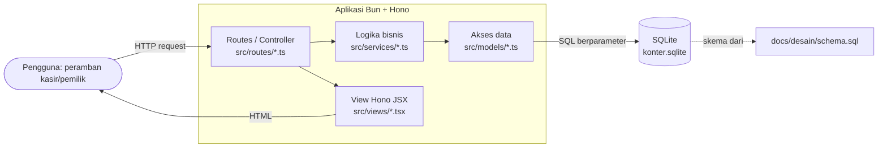

# Arsitektur Aplikasi — RPL Konter Sampit

> Jobsheet 6, Langkah 12. Arsitektur berlapis untuk **Bun + Hono + `bun:sqlite`**. Pembagian lapisan mengikuti semangat MVC pada jobsheet: controller → logika bisnis → akses data → basis data, dengan view terpisah.

## 1. Diagram arsitektur



Alur satu permintaan (contoh `POST /api/transaksi`):

1. `src/routes/transaksi.ts` menerima form, tidak menulis SQL dan tidak memutuskan aturan bisnis.
2. `src/services/transaksi.ts` memvalidasi masukan, menghitung operator, memeriksa stok, dan memutuskan kasbon.
3. `src/models/transaksi.ts` menyimpan transaksi, memotong stok voucher, dan membuat kasbon dalam **satu transaksi basis data**.
4. Route mengalihkan ke beranda (Post–Redirect–Get); `src/views/beranda.tsx` merender HTML dengan auto-escape JSX.

## 2. Struktur folder dan tanggung jawab

```
rpl-konter-sampit/
├── src/
│   ├── index.ts              # Entrypoint: inisialisasi DB, skema, seed, konfigurasi server
│   ├── app.ts                # Merakit Hono app, middleware, dan semua rute
│   ├── config.ts             # Validasi konfigurasi/lingkungan
│   ├── versi.ts              # Versi aplikasi (1.0.0)
│   ├── middleware/           # muatPengguna, wajibMasuk, wajibPeran, pasangCsrf
│   ├── db/
│   │   ├── connection.ts     # Membuka koneksi, PRAGMA foreign_keys + WAL, akses db aktif
│   │   ├── schema.ts         # Menerapkan docs/desain/schema.sql (sumber kebenaran DDL)
│   │   └── seed.ts           # Data contoh voucher untuk pengembangan
│   ├── models/               # SATU-SATUNYA lapisan yang menulis SQL
│   │   ├── voucher.ts
│   │   ├── voucher-masuk.ts
│   │   ├── transaksi.ts
│   │   ├── pelanggan.ts
│   │   ├── pengguna.ts
│   │   └── kasbon.ts
│   ├── services/             # Aturan bisnis dan validasi; tanpa SQL dan tanpa HTML
│   │   ├── operator.ts
│   │   ├── validasi.ts
│   │   ├── transaksi.ts
│   │   ├── voucher.ts
│   │   ├── voucher-masuk.ts
│   │   ├── pencarian.ts
│   │   ├── kasbon.ts
│   │   ├── autentikasi.ts
│   │   └── batas-login.ts
│   ├── routes/               # Controller HTTP tipis
│   │   ├── autentikasi.ts
│   │   ├── beranda.ts
│   │   ├── transaksi.ts
│   │   ├── voucher.ts
│   │   ├── voucher-masuk.ts
│   │   ├── riwayat.ts
│   │   ├── laporan.ts
│   │   └── kasbon.ts
│   ├── views/                # Tampilan Hono JSX (auto-escape)
│   │   ├── layout.tsx
│   │   ├── login.tsx
│   │   ├── 403.tsx
│   │   ├── beranda.tsx
│   │   ├── voucher.tsx
│   │   ├── voucher-masuk.tsx
│   │   ├── riwayat.tsx
│   │   ├── laporan.tsx
│   │   └── komponen.tsx
│   └── lib/                  # Utilitas murni
│       ├── waktu.ts          # Waktu lokal Asia/Jakarta, format ISO, selisih hari
│       ├── format.ts         # Format rupiah
│       ├── teks.ts           # Escape LIKE
│       ├── sesi.ts           # Cookie sesi bertanda tangan
│       ├── csrf.ts           # Token CSRF
│       └── backup.ts         # VACUUM INTO
├── public/                   # style.css dan app.js (aset statis)
├── scripts/                  # buat-pengguna, demo, cadangan, rekap jurnal
├── docs/desain/              # ERD, normalisasi, kamus data, schema.sql, arsitektur
├── tests/                    # 12 berkas *.test.ts + cek_skema.ts
│   ├── bantuan.ts            # Database uji in-memory + skema
│   ├── sesi-bantuan.ts       # Cookie jar, akun, login uji
│   ├── cek_skema.ts          # Skrip uji pelanggaran skema (versi Bun dari Lampiran B.2)
│   ├── auth.test.ts
│   ├── keamanan.test.ts
│   ├── laporan.test.ts
│   ├── operator.test.ts
│   ├── pencarian.test.ts
│   ├── rilis.test.ts
│   ├── transaksi.test.ts
│   ├── validasi.test.ts
│   ├── voucher-crud.test.ts
│   ├── voucher-masuk.test.ts
│   ├── voucher-status.test.ts
│   └── waktu.test.ts
├── PRD.md
├── aturan-proyek.md
├── package.json
└── tsconfig.json
```

## 3. Aturan lapisan

| Lapisan | Boleh | Tidak boleh |
|---|---|---|
| `routes/` | Menerima HTTP, membaca query/form, memanggil service, memilih view, redirect | Menulis SQL, memuat `bun:sqlite`, memutuskan aturan bisnis |
| `middleware/` | Memuat sesi, memeriksa peran, menyediakan token CSRF | Menulis SQL/HTML tampilan |
| `services/` | Validasi, aturan bisnis, memanggil model, menyusun pesan | Menulis SQL langsung, menghasilkan HTML |
| `models/` | SQL berparameter, transaksi basis data, memetakan baris ke tipe | Menghasilkan HTML, memutuskan pesan antarmuka |
| `views/` | Merender data menjadi HTML/JSX | Menulis SQL, mengubah data |
| `db/` | Koneksi, PRAGMA, menerapkan skema, seed | Aturan bisnis |
| `lib/` | Utilitas murni (waktu, format, teks) dan helper teknis (sesi, CSRF, backup) | Mengakses model, menulis SQL, menghasilkan HTML |

Aturan tambahan:

1. `docs/desain/schema.sql` adalah satu-satunya sumber DDL. **Tidak ada** `CREATE TABLE` di kode aplikasi; `src/db/schema.ts` mengeksekusi berkas itu saat aplikasi mulai.
2. Setiap koneksi mengaktifkan `PRAGMA foreign_keys = ON`; SQLite mengabaikan kunci asing bila PRAGMA ini lupa.
3. Semua query memakai parameter (`?`), tidak pernah menyambung teks masukan pengguna.
4. Data pengguna pada view dirender lewat JSX (`{nilai}`), bukan penyambungan HTML mentah. `dangerouslySetInnerHTML` hanya untuk CSS/JS statis milik aplikasi.
5. Pengujian memakai basis data sementara/in-memory; `konter.sqlite` tidak boleh tersentuh oleh `bun test`.
6. Waktu dicatat lewat `src/lib/waktu.ts` (zona Asia/Jakarta), bukan `new Date().toISOString()` langsung, agar rekap harian benar pada dini hari WIB.

## 4. Urutan modul Sprint 1 (dari `docs/product-backlog.md`)

| Urutan | Modul | KF | Tugas backlog |
|:---:|---|---|---|
| 1 | Fondasi: koneksi SQLite, `schema.sql`, seed | — | TSK-101, TSK-106 |
| 2 | Deteksi operator dan validasi nomor HP | KF-02 | TSK-102, TSK-103 |
| 3 | Form dan endpoint transaksi pulsa/data/token | KF-01 | TSK-104, TSK-105 |
| 4 | Penjualan voucher: pemotongan stok dan penolakan stok habis | KF-03, KF-04 | TSK-107, TSK-108 |
| 5 | Modul voucher masuk: daftar JOIN + tambah stok atomik | KF-10 | TSK-110, TSK-111 |
| 6 | Pencarian dan filter riwayat | KF-11 | TSK-112 |
| 7 | Uji regresi `bun test` dan tinjauan PR | DoD | TSK-109 |

Modul Sprint 2 sudah dikerjakan: rekap laporan (KF-05), kasbon penuh (KF-06/KF-07), autentikasi dua peran (KF-08), CSRF/rate limit/header (KNF-05).

## 5. Kesiapan Jobsheet berikutnya

- **Jobsheet 7 (wireframe & rencana uji):** halaman yang sudah ada (beranda/kasir) menjadi acuan wireframe; test case diturunkan dari KF dan `kamus-data.md`.
- **Jobsheet 9–10 (CRUD, relasi, pencarian):** model dan service baru cukup ditambahkan pada folder masing-masing; route tidak perlu menyentuh SQL.
- **Jobsheet 11 (autentikasi):** tabel `pengguna` sudah ada; middleware sesi/peran dipasang di `app.ts`, sedangkan aturan peran tetap di service.
- **Jobsheet 13 (pytest → Bun test):** `tests/` sudah memakai basis data in-memory, sehingga uji dapat ditambah tanpa mengotori data kerja.
