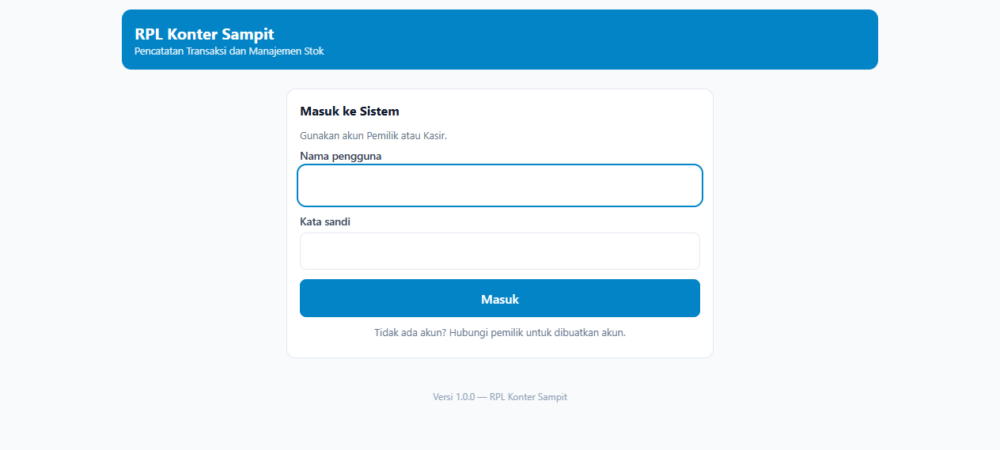
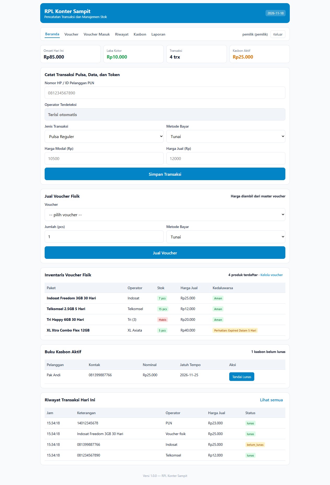
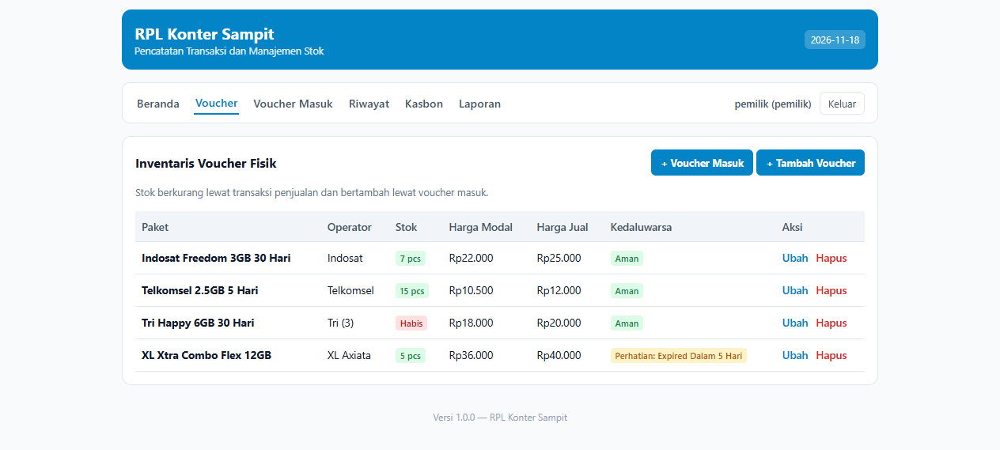
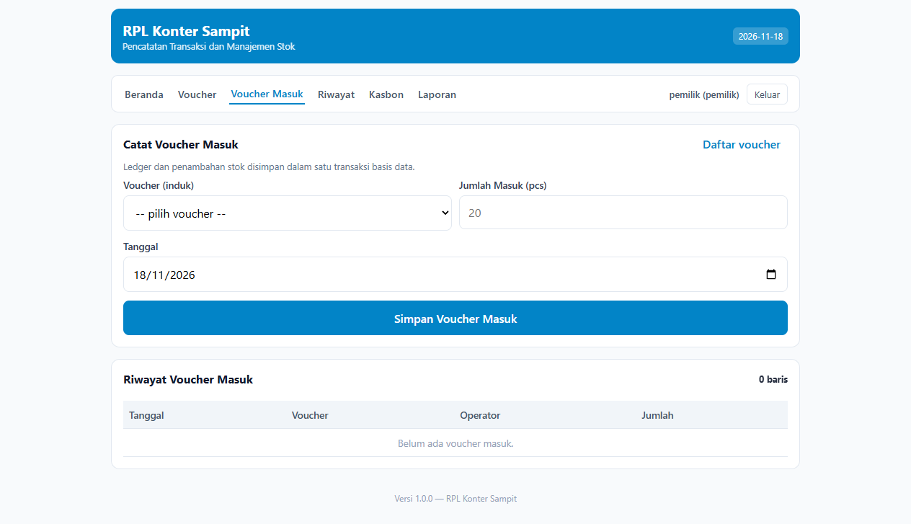
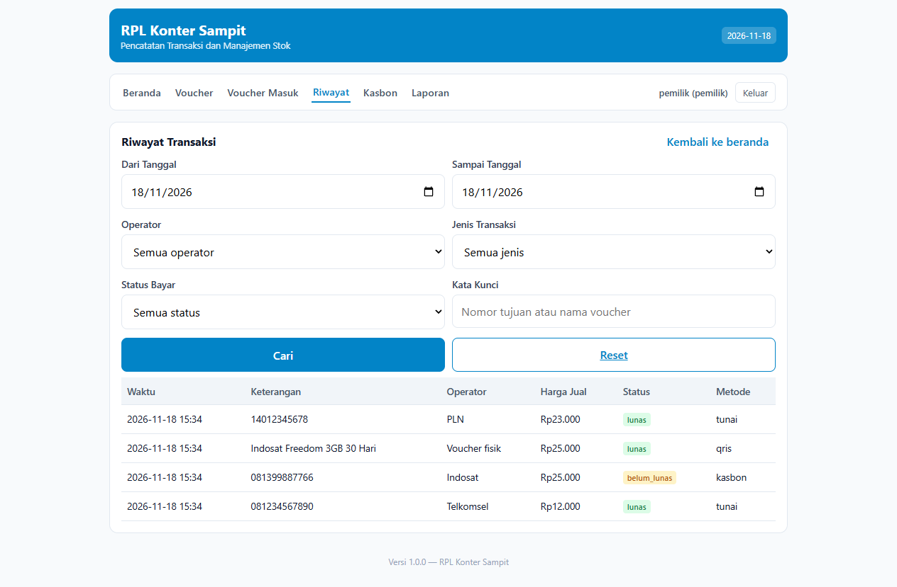
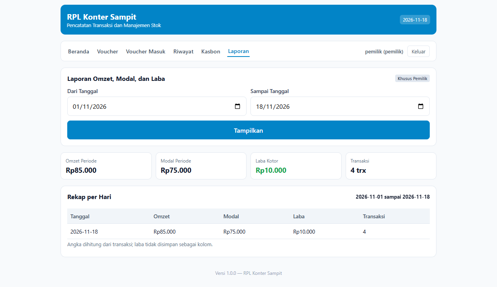
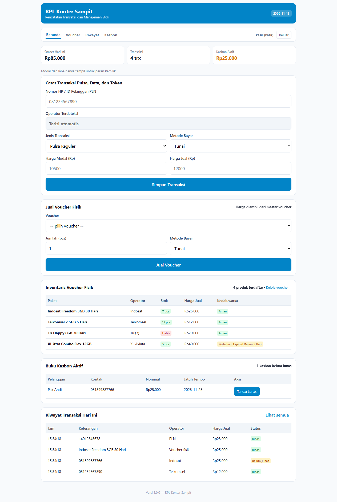
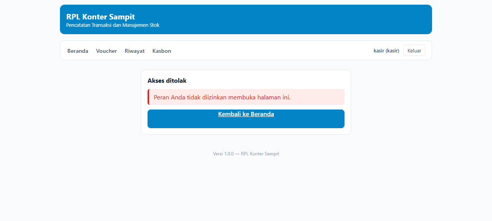

# Manual Pengguna — RPL Konter Sampit v1.0.0

> Untuk **Pemilik** dan **Kasir** konter. Tidak perlu pengetahuan teknis. Semua gambar memakai data karangan.

## Daftar isi

1. Masuk dan keluar
2. Beranda Pemilik
3. Mencatat transaksi pulsa/data/token
4. Menjual voucher fisik
5. Mengelola stok voucher
6. Mencatat voucher masuk
7. Buku kasbon dan pelunasan
8. Riwayat dan filter
9. Laporan
10. Tampilan Kasir dan akses ditolak
11. Jika ada masalah

---

## 1. Masuk dan keluar

1. Buka alamat aplikasi (contoh `http://localhost:3000`).
2. Isi **Nama pengguna** dan **Kata sandi**.
3. Klik **Masuk**.
4. Untuk keluar, klik tombol **Keluar** di kanan atas.

Jika kata sandi salah, pesan yang muncul sama dengan saat nama pengguna tidak ada. Hubungi pemilik bila akun belum dibuat. Akun dibuat oleh pemilik melalui `bun run buat:pengguna`.

---

## 2. Beranda Pemilik

Pemilik melihat omzet, laba kotor, jumlah transaksi, kasbon aktif, peringatan voucher, dan riwayat hari ini.

Warna lencana:

- **Hijau** — aman/lunas.
- **Kuning** — perhatian (voucher ≤7 hari atau kasbon belum lunas).
- **Merah** — habis, kedaluwarsa, atau lewat tempo.

Menu **Laporan** dan **Voucher Masuk** hanya tampil untuk Pemilik.

---

## 3. Mencatat transaksi pulsa/data/token

1. Di beranda, isi **Nomor HP / ID Pelanggan PLN** (10–13 digit).
2. **Operator Terdeteksi** terisi otomatis; server menghitung ulang saat disimpan.
3. Pilih **Jenis Transaksi**: Pulsa Reguler, Paket Data, atau Token Listrik PLN.
4. Pilih **Metode Bayar**: Tunai, QRIS Toko, atau Kasbon.
5. Isi **Harga Modal** dan **Harga Jual**. Harga jual tidak boleh di bawah modal.
6. Bila memilih **Kasbon**, isi nama pelanggan, kontak (opsional), dan tanggal jatuh tempo.
7. Klik **Simpan Transaksi**.

Setelah berhasil, halaman kembali ke beranda dan menampilkan pesan sukses. Bila ada kesalahan, isian tetap tersimpan dan pesan galat muncul di atas.

Untuk token listrik, operator otomatis **PLN**. Nomor yang dimasukkan adalah ID pelanggan/meter.

---

## 4. Menjual voucher fisik

1. Pada kartu **Jual Voucher Fisik**, pilih voucher.
2. Isi **Jumlah (pcs)**.
3. Pilih metode bayar; bila Kasbon, lengkapi data pelanggan.
4. Klik **Jual Voucher**.

Harga diambil dari master voucher, bukan dari isian. Stok berkurang otomatis. Bila stok 0, muncul pesan **“Stok voucher habis!”** dan tidak ada data yang tersimpan. Bila jumlah melebihi stok, pesan menyebut sisa stok.

---

## 5. Mengelola stok voucher

Buka menu **Voucher**.

- **+ Tambah Voucher** — membuat master voucher baru (nama paket, operator, stok awal, harga modal, harga jual, tanggal kedaluwarsa).
- **Ubah** — mengubah nama/operator/harga/expired. **Stok tidak diubah dari form ini.**
- **Hapus** — meminta konfirmasi; voucher yang sudah dipakai transaksi tidak dapat dihapus.
- **+ Voucher Masuk** — menambah stok lewat ledger.

Voucher dengan stok 0 diberi lencana **Habis**. Voucher yang mendekati expired diberi lencana kuning; yang sudah lewat diberi lencana merah.

---

## 6. Mencatat voucher masuk

1. Buka **Voucher Masuk**.
2. Pilih voucher induk.
3. Isi jumlah masuk dan tanggal.
4. Klik **Simpan Voucher Masuk**.

Stok bertambah tepat sejumlah isian dan satu baris ledger muncul. Bila voucher tidak ada atau tanggal salah, tidak ada perubahan stok.

---

## 7. Buku kasbon dan pelunasan

Di beranda, bagian **Buku Kasbon Aktif** menampilkan pelanggan, kontak, nominal, jatuh tempo, dan tombol **Tandai Lunas**. Tanggal yang sudah lewat diberi lencana **Lewat tempo**.

- Untuk mencatat kasbon baru, pilih metode **Kasbon** saat transaksi.
- Untuk melunasi, klik **Tandai Lunas** dan konfirmasi. Status berubah menjadi lunas dan tanggal pelunasan dicatat.
- Menekan tombol pada kasbon yang sudah lunas akan ditolak.

---

## 8. Riwayat dan filter

Buka menu **Riwayat**.

1. Pilih rentang tanggal.
2. Pilih operator, jenis, dan status bila perlu.
3. Isi kata kunci nomor tujuan atau nama voucher.
4. Klik **Cari**; klik **Reset** untuk kembali ke hari ini.

Kasir hanya melihat transaksi hari ini; kolom tanggal dikunci. Pemilik dapat memilih rentang lebih luas. Bila tidak ada hasil, muncul **“Tidak ada transaksi yang cocok.”**

---

## 9. Laporan

Menu **Laporan** hanya untuk Pemilik.

1. Pilih tanggal awal dan akhir.
2. Klik **Tampilkan**.
3. Lihat omzet, modal, laba kotor, jumlah transaksi, dan rekap per hari.

Angka dihitung dari transaksi; laba tidak disimpan sebagai kolom terpisah.

---

## 10. Tampilan Kasir dan akses ditolak

Kasir tidak melihat laba/modal di beranda dan tidak melihat menu Voucher Masuk/Laporan.

Jika kasir membuka alamat halaman Pemilik secara langsung (mis. `/laporan`), muncul halaman **Akses ditolak**.

Penjagaan dilakukan di server, bukan hanya dengan menyembunyikan tautan.

---

## 11. Jika ada masalah

| Gejala | Tindakan |
|---|---|
| Login gagal padahal kata sandi benar | Pastikan akun dibuat pada `KONTER_DB` yang sama; minta pemilik membuat akun baru. |
| Sesi langsung hilang | Periksa `SECRET_KEY`; bila server restart dengan `.env` kosong, secret pengembangan berubah. |
| Tidak bisa login dari komputer lain via HTTP | Set `COOKIE_SECURE=0` untuk LAN HTTP; gunakan `1` hanya dengan HTTPS. |
| Stok tidak berubah | Pastikan transaksi berhasil; cek menu Riwayat dan Voucher Masuk. |
| Pesan “Sesi form kedaluwarsa” | Muat ulang halaman lalu kirim ulang form. |
| Data hilang setelah update | Pulihkan dari `backup/` sesuai README; hentikan aplikasi sebelum menyalin. |

Jangan mengirim kata sandi atau data pelanggan nyata melalui chat/AI. Untuk bantuan teknis, hubungi pengembang dengan menyebutkan langkah reproduksi dan pesan galat (tanpa data sensitif).
